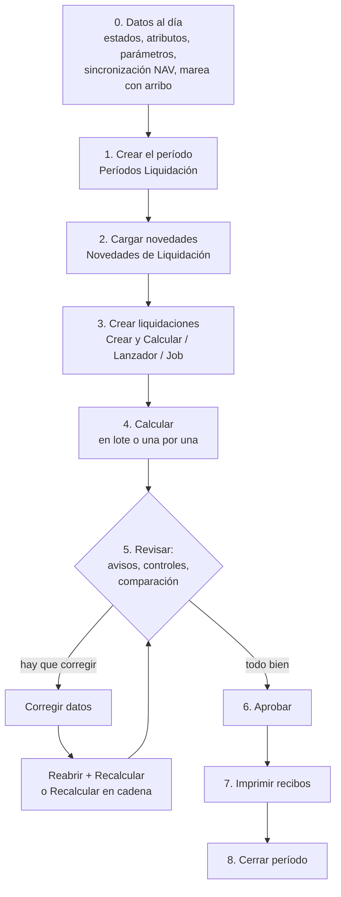

# Flujo operativo mensual de liquidación

## Objetivo

Llevar un mes desde "los datos están cargados" hasta "recibos impresos y período cerrado". Es la receta del liquidador; cada paso apunta a la nota que lo detalla.

## Pasos

### 0. Antes de empezar (datos al día)

Nada de esto lo hace el botón de liquidar; si falta, el cálculo sale vacío o corto **sin error**:

1. **Sincronización NAV**: abrir *Sincronización con NAV* y verificar que no haya filas pendientes ni en error (proyectos, empleados, descargas). Los empleados que llegan de NAV nacen **sin convenio ni categoría**: completarlos en la vista *Pendientes de completar (Sinc.)* de la lista de empleados; "hasta que los tengan, el motor no les arma ninguna liquidación". → [[Sincronización NAV - visión general]]
2. **Estados y fases de alta** de cada empleado (Historial de Estados, Fases de Alta): el motor exige estado a la fecha de referencia y las altas definen si el empleado "pertenecía a la empresa" ese mes. → [[estado-empleado-effective-dated]], [[tres-capas-fase-estado-asignacion]]
3. **Atributos** del empleado (convenio, categoría, zona, sindicato, obra social…) con vigencia al mes. → [[atributos-tipados]]
4. **Parámetros vigentes del mes** (topes SIPA, SMVM, cotizaciones, precios por categoría). El cálculo avisa si el último valor es más viejo que la *Antigüedad Máxima Vigencia* configurada. → [[Configurar un parámetro y su vigencia]]
5. **Mareas**: para Cierre de Marea el proyecto debe tener **fecha de arribo** (*Ending Date*); sin ella la acción está deshabilitada y el lote devuelve el error "El proyecto … no tiene fecha de arribo".
6. **Préstamos y SIRADIG** cargados ([[Importación SIRADIG - operación]]).
7. Correr **Fórmulas con errores** y **Control de Orden de Cálculo** si se tocó configuración. → [[Controles y avisos del cálculo]]

### 1. Crear el período

*Períodos* → **Nuevo**: completar **Año** y **Mes**. El *Código* se arma solo como `aaaamm` (p. ej. `202610`) y las fechas Desde/Hasta se completan con el primer y último día del mes ([[periodos-aaaamm]]). El *Cód. Calendario* es opcional: define días no laborables para `DIAS_HAB`; vacío = lunes a viernes. Un período nuevo nace *Abierto*.

### 2. Cargar novedades

*Novedades de Liquidación* → elegir el período → importar de Excel/CSV, copiar del período anterior o generar recurrentes. **Antes de cerrar el período las pendientes tienen que estar en cero**: lo que quede pendiente "no se le pagó a nadie". → [[Novedades e incidencias - carga operativa]]

### 3 y 4. Crear y calcular

La forma habitual: *Períodos* → **Crear y Calcular Liquidaciones**. Crea, calcula y descarta las que salen vacías. Alternativas: *Lanzador de Liquidaciones* (por período y tipo), acciones del *Job* (por marea) o *Crear Liq. para Empleado*. → [[Lanzador de liquidaciones y lotes]]

Un lote puede tardar: muestra una ventana de progreso con la liquidación en curso, el paso y el tiempo. Al terminar, si hubo cinco o más avisos, abre el informe **Avisos del cálculo**. → [[Controles y avisos del cálculo]]

### 5. Revisar

En este orden suele rendir más:

1. **Registros de Proceso** con filtro *Solo con error*: qué liquidaciones fallaron y por qué.
2. **Avisos del cálculo** (informe) — parámetros desactualizados, acumuladores leídos antes de tiempo, novedades salteadas.
3. **Días Liquidados por Empleado**: días con estado que ninguna liquidación cubrió.
4. **Control de Liquidación por Período / por Marea**: matriz concepto × empleado y lista de quién cobró distinto que su categoría.
5. **Novedades de Liquidación**: pendientes y "con motivo de no aplicación".
6. Durante la corrida en paralelo, **Comparar BC contra Meta4**.
7. Abrir casos puntuales: *Ficha Liquidación* → líneas, *Detalle del cálculo*, variables. → [[Asistente de fórmulas y detalle del cálculo]]

### 6. Corregir

Cambió un dato → **Reabrir** (vuelve a Borrador y libera las novedades) → **Calcular** otra vez. Si el empleado tiene períodos *posteriores* ya calculados, reabrir se bloquea: usar **Recalcular en cadena**. → [[Crear, calcular, aprobar y reabrir liquidaciones]]

### 7. Aprobar

Lista o Ficha → **Aprobar** (sólo desde *Calculada*); en el Árbol, sobre el nodo del mes o del tipo. Al aprobar, las cuotas de préstamo asociadas quedan marcadas como aplicadas.

### 8. Imprimir recibos

*Imprimir Recibo* desde la Ficha, la Lista (uno o selección) o el Árbol (nodo entero). Activar **Solo liquidaciones aprobadas/contabilizadas** en la ventana del informe. → [[Recibo de sueldo (reporte)]]

### 9. Cerrar el período

*Períodos* → **Cerrar Período**. Pide confirmación y registra fecha y usuario. Un período cerrado no admite crear ni calcular.

> [!warning] El cierre no controla nada
> Cerrar Período **no verifica** que todas las liquidaciones estén aprobadas ni que no queden novedades pendientes: sólo cambia el estado. Esa revisión es manual (paso 5).

> [!note] El cierre sí se puede deshacer
> La confirmación dice "no se puede deshacer", y `GUIA-LIQUIDACION.md` también lo afirmaba, pero la acción **Reabrir Período** existe: devuelve a Borrador las liquidaciones *Calculada*/*Aprobada* que no tengan posteriores y reabre el período. Se **niega** si hay liquidaciones *Contabilizada* (aunque hoy nada genera ese estado, ver [[Qué es y para qué sirve este sistema]]).

## Verificación

- *Períodos*: el período figura *Cerrado* con fecha y usuario de cierre.
- *Árbol de Liquidaciones*: todos los nodos del mes en estado *Aprobada* y subtotales cuadrados contra lo esperado.
- *Novedades*: Pendientes = 0.
- *Días Liquidados por Empleado*: *Con faltantes* = 0 para el rango del mes.

## Relacionado

[[Mapa de páginas por menú]] · [[Resolución de problemas frecuentes]] · [[lote-tipo-liq-en-blanco]] · [[ventana-liquidacion-es-cobertura]]

## Ver también

[[Ciclo de cálculo de una liquidación]] · [[Tipos de liquidación]] · [[Cuándo corresponde una liquidación]] · [[Novedades pre-liquidación]] · [[Control de períodos liquidados]] · [[Runbook - tareas frecuentes]]
