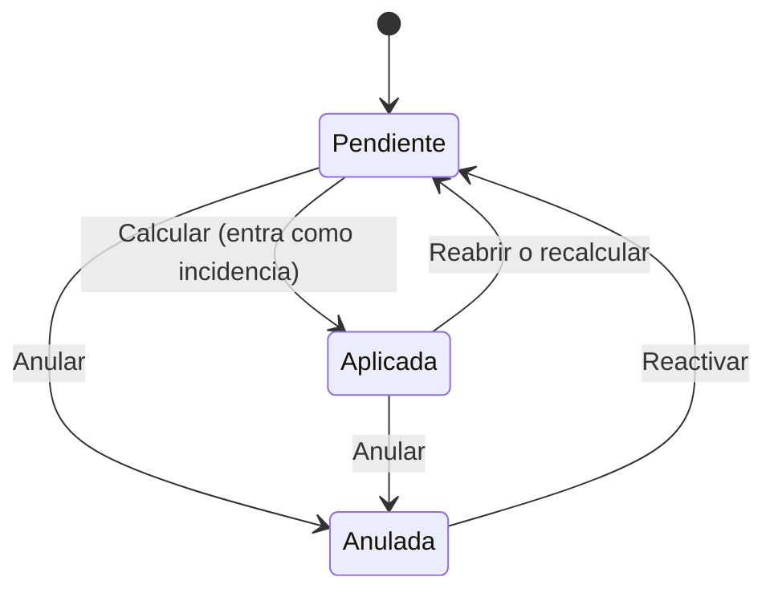

# Novedades e incidencias: carga operativa

Los **importes que no salen de una fórmula** (horas extras, premios, anticipos, descuentos judiciales, ajustes) entran por dos puertas. Explicación de diseño en [[novedades-pre-liquidacion]]; esta nota es el procedimiento.

| | **Novedad** | **Incidencia** |
|---|---|---|
| Se carga contra… | un **período** (antes de que exista la liquidación) | una **liquidación** en Borrador |
| Pantalla | *Novedades de Liquidación* (hoja) | Subpágina *Incidencias* de la ficha; *Insertar Incidencia Masiva* |
| Cuándo llega al cálculo | **Automáticamente** al calcular: el motor la materializa como incidencia | Ya está |
| Vigencia | Se repite con *Recurrente* | Sólo esa liquidación |
| Recomendada para | **Todo lo mensual** | Retoques puntuales |

## Qué hace una novedad en el cálculo

El motor distingue tres modos según lo que se cargue (desde el 30/9/2026), y **la novedad gana sobre la fórmula** del concepto ([[novedad-en-cero-no-apagaba-el-concepto]]):

| Importe | Cantidad | Efecto |
|---|---|---|
| ≠ 0 | cualquiera | El importe **reemplaza** a la fórmula |
| 0 | ≠ 0 | La **fórmula valoriza** la cantidad (horas extras: la cantidad llega a la fórmula como `CANT_INCIDENCIA`) |
| 0 | 0 | **Cero explícito**: el concepto no paga y la fórmula ni se evalúa |

Varias novedades del mismo concepto y empleado **se suman en una sola incidencia**. Una incidencia **hecha a mano** (o por préstamos) **se respeta** y la novedad queda *Pendiente* con el motivo anotado.

## Cargar novedades (hoja)

*Novedades de Liquidación* (Worksheet 50013): elegir **Período** (propone el que contiene la fecha de trabajo). Los únicos datos **obligatorios** son **Período** y **Concepto**; todo lo demás se puede dejar en blanco y el motor lo resuelve.

| Campo | Cómo se usa |
|---|---|
| **No. Empleado** | En blanco = **novedad colectiva**: alcanza a todos los que cumplan Convenio, Categoría y Tipo |
| **Cód. Convenio**, **Cód. Categoría**, **Cód. Tipo Liq.** | Selectores. En blanco = cualquiera. La columna **Alcance** los lee juntos |
| **Fecha** | Día **dentro del período**; decide en qué liquidación entra (qué estaba haciendo el empleado ese día). En blanco aplica a todo el período |
| **No. Proyecto** | **Dejar en blanco**: lo deduce la fecha mirando el historial de estados. Cargarlo **fuerza** la marea e ignora el historial |
| **Cód. Concepto** | Obligatorio |
| **Cantidad**, **Unidad Cantidad**, **Valor Unitario**, **Importe** | Con cantidad y valor el importe se calcula solo; también se puede escribir |
| **Recurrente** / **Períodos Restantes** | Se regenera el período siguiente con *Generar recurrentes*; 0 con Recurrente = indefinidamente |
| **Estado**, **No. Liquidación**, **Motivo No Aplicada** | Resultado del último cálculo |
| **Observaciones** | Libre |

Cabecera de la hoja: contadores **Pendientes**, **Aplicadas**, **Con motivo de no aplicación** y **Anuladas**.

Reglas de carga: la fecha debe caer **dentro del período** ("La fecha %1 está fuera del período %2"); el período no puede estar cerrado; **una novedad ya aplicada en una liquidación que no está en Borrador no se modifica** ("Reabrí la liquidación para modificarla").

### Estados

### Acciones

| Acción | Efecto |
|---|---|
| **Importar de Excel/CSV** | Una por fila, columnas **en este orden**: No. Empleado, Cód. Concepto, Cantidad, Valor Unitario, Importe, Fecha, Cód. Tipo Liq., Observaciones, No. Proyecto. Saltea el encabezado y las filas cuyo empleado o concepto no exista, y las informa al final. **Convenio y categoría quedan en blanco** |
| **Copiar de otro período** | Copia al período actual (propone el anterior) saltando las que ya existen para el mismo empleado, concepto, convenio, categoría y tipo |
| **Generar recurrentes** | Trae las *Recurrente* del período inmediatamente anterior y descuenta un período al contador. **Se puede correr dos veces sin duplicar** |
| **Anular** | La excluye: no se aplica, no se copia, no se recurre. Si ya había entrado en una liquidación en **Borrador**, se deshace lo generado y el próximo cálculo la rearma sin ella |
| **Reactivar** | Vuelve a Pendiente para el próximo cálculo |

## Cómo se decide en qué liquidación entra

Un empleado puede tener **varias liquidaciones en el mes** (regular, cierre de marea, vacaciones…). La novedad entra en **una sola**, según:

1. **Tipo Liq. explícito**: si la novedad nombra un tipo, la fecha **no** se mira como filtro (antes un tipo y una fecha contradictorios dejaban la novedad sin entrar en ninguna; [[novedad-tipo-liq-y-fecha-se-pelean]]).
2. **Proyecto**: si nombra uno, manda. Si está en blanco, se usa el **proyecto del estado** del empleado a la fecha de la novedad (navegando → la marea; en francos/órdenes → el proyecto de nómina) ([[novedad-proyecto-sale-del-estado]]).
3. Si el proyecto del estado no tiene liquidación propia, la novedad entra igual ([[novedad-estado-apunta-a-proyecto-sin-liquidar]]).
4. Una novedad **con proyecto** donde el empleado no tuvo liquidación de ese proyecto quedó huérfana sin aviso hasta la corrección del 28/9/2026 ([[novedad-con-proyecto-queda-huerfana]]).
5. Una vez aplicada, **no entra en otra liquidación** del mismo empleado.

> [!tip] Al migrar o cargar muchas
> **No derivar** proyecto, convenio ni categoría: dejarlos en blanco. Cargar un proyecto "para precisión" es inventar un dato que el origen no tiene y puede dejar la novedad sin entrar en ninguna, sin aviso.

## Cuando una novedad no aparece

La ficha de la liquidación tiene la acción **Novedades del período**, y la subpágina **Novedades aplicadas** → *Abrir hoja de novedades* (acotada al empleado y las colectivas). Mirar la columna **Motivo No Aplicada**. Si está vacía y el estado es *Pendiente*, repasar la lista de arriba (proyecto, tipo, fecha, cobertura de la liquidación). Antes de cerrar el período, **Pendientes = 0**: "lo que quede acá no se le pagó a nadie".

## Incidencias (a mano)

*Ficha Liquidación* → subpágina **Incidencias** (editable sólo en **Borrador**): **Cód. Concepto**, Cantidad, Unidad, Valor Unitario, **Importe**, Observaciones. Para la misma incidencia en muchas liquidaciones: **Insertar Incidencia Masiva** ([[Reportes y procesos masivos]]). Modificar o borrar una incidencia con la liquidación fuera de Borrador se rechaza ("Solo se pueden modificar incidencias en liquidaciones en estado Borrador"). Editar a mano una incidencia **generada por una novedad** la convierte en manual y la **protege** del recálculo.

## Conceptos pensados para novedades

Los de anticipos, recuperos y descuentos judiciales (4803, 4813, 4823, 8850, 4115…) están **sin fórmula a propósito**: se cargan siempre como novedad ([[anticipos-como-novedades]]). El anticipo es un descuento con cuenta corriente, no un haber del recibo ([[anticipo-no-es-haber-del-recibo]]).

## Relacionado

[[Flujo operativo mensual de liquidación]] · [[Controles y avisos del cálculo]] · [[Reportes y procesos masivos]] · [[Resolución de problemas frecuentes]]

## Ver también

[[Novedades pre-liquidación]] · [[Incidencias]] · [[Incidencias en el motor]] · [[Tabla - Novedad Liquidación]] · [[Tabla - Incidencia Liquidación]]
