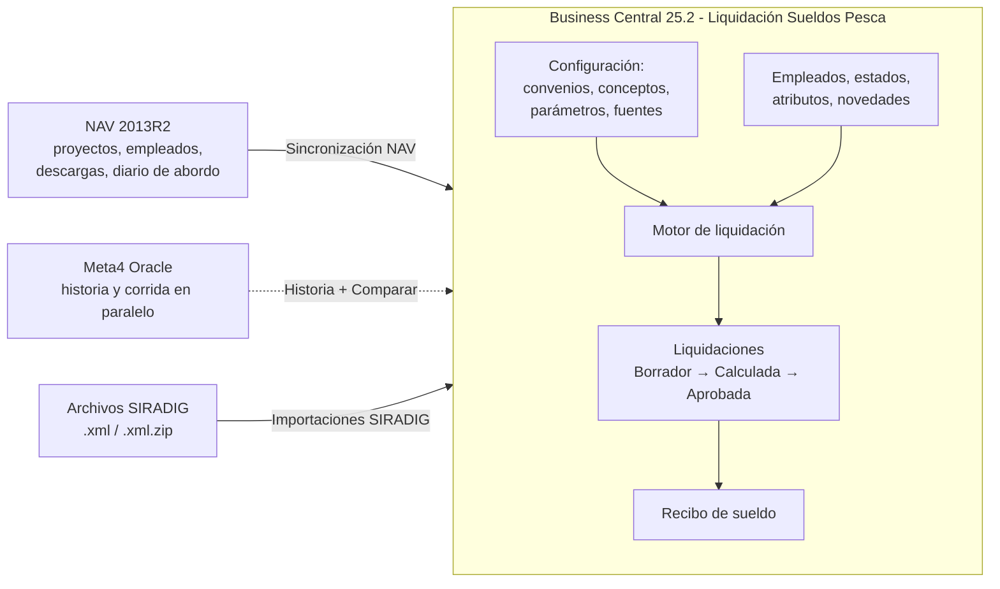

# Qué es y para qué sirve este sistema

## En una frase

*Liquidación Sueldos Pesca* es una extensión de Business Central 25.2 (Grupo Arbumasa) que **liquida haberes de personal embarcado y de tierra de la industria pesquera argentina** dentro del propio ERP: los empleados, los proyectos (mareas), los buques y las dimensiones son los mismos registros de BC. El cálculo **se configura, no se programa**: conceptos con fórmulas, parámetros con vigencia, fuentes de datos y atributos con historial ([[avoid-tables-principle]]).

## Qué resuelve

| Necesidad | Cómo lo cubre el sistema |
|---|---|
| Liquidar **por marea** (devengados mientras navega, cierre al arribo, producción y coeficientes) | Tipos de liquidación con *disparador* (Arribo de marea, Marea en curso, Baja del empleado) — ver [[Lanzador de liquidaciones y lotes]] |
| **Convenios y categorías** (CCT 175/75, 768/19, 729/15, 130/75, 372/04, sin CCT) | Par convenio/categoría como atributo del empleado con vigencias; conceptos y parámetros se resuelven por ese par |
| **Francos** valuados por la categoría del lote en que se ganaron | Ledger FIFO ([[francos-fifo-ledger]]) |
| **Cambios de reglas sin desarrollo** | Fórmulas versionadas por fecha ([[Configurar un concepto (guía paso a paso)]]) |
| **Trazabilidad**: poder explicar cualquier importe | Cada línea guarda fórmula aplicada, fórmula con valores y variables ([[Asistente de fórmulas y detalle del cálculo]]) |
| **Control antes de pagar** | Registros de proceso, avisos, controles de orden, de cobertura y de marea ([[Controles y avisos del cálculo]]) |
| **Ganancias 4.ª categoría** | Importación SIRADIG, deducciones por familiar, detalle por etapas en el recibo |
| **Préstamos y anticipos** | Cuotas que generan incidencias automáticas al calcular |

## Quiénes lo usan

| Usuario | Qué hace | Perfil / permisos |
|---|---|---|
| **Liquidador de sueldos** (RR.HH.) | Carga novedades, crea y calcula liquidaciones, revisa, aprueba, imprime recibos | Perfil `PAYROLL-MANAGER` + *Liq. Pesca - Liquidador* |
| **Responsable de configuración** (Director de TI / consultor) | Define convenios, conceptos, parámetros, fuentes de datos, tipos de liquidación; corrige | Perfil `DIRECTOR-TI` + *Liq. Pesca - Admin* |
| **Auditoría / consulta** | Mira liquidaciones, líneas, controles e imprime recibos | *Liq. Pesca - Lectura* |

Detalle en [[Perfiles, Role Center y permisos]].

## Qué reemplaza: Meta4

La nómina vivía en **Meta4** (Oracle). El sistema nace como reemplazo y **en 2026 corrió en paralelo**: por eso existen la historia de liquidaciones de Meta4 importada (página *Historia de Liquidaciones (Meta4)*) y la pantalla *Comparar BC contra Meta4*, que pone lado a lado lo liquidado por empleado y mes. Mientras Meta4 siga siendo producción, esa comparación es lo que dice si el motor de BC está dando bien. Las lecciones de la migración están en [[migracion-estados-meta4]], [[migracion-novedades-meta4]] y [[historia-remuneraciones-migrada]].

Los datos operativos de pesca (proyectos, empleados, descargas, informes del capitán, diario de abordo, valores de dimensión) venían de **NAV 2013R2** y se traen con la sincronización descripta en [[Sincronización NAV - visión general]].

## Alcance: qué hace y qué no

**Hace** (verificado en el código): liquidación mensual y por marea, SAC, vacaciones, liquidación final, reliquidación; grossing-up para netos garantizados; Ganancias 4.ª con deducciones; préstamos/anticipos; novedades pre-liquidación; recibo de sueldo en RDLC; importación SIRADIG; sincronización NAV; comparación contra Meta4.

**No hace (o no está implementado)**:

- **Firma digital de recibos, onboarding, legajo digital, gestión documental**: la propuesta comercial los declara fuera de alcance; el diseño de la firma está sólo como propuesta ([[firma-recibos-digitales]]).
- **Contabilización**: el enum `Estado Liq.` tiene el valor `Contabilizada` y varias pantallas lo contemplan, pero **ningún código lo asigna** (se buscó `Estado := Contabilizada` en todo `src`). Hoy el flujo termina en *Aprobada*. La propuesta habla de "asiento contable directo, sin interfaz": **no está construido**.
- **Libro de Sueldos Digital**: figura en la propuesta como salida; no se encontró ningún objeto AL que lo genere. Desde el 12/10/2026 sí existe la declaración de **SICOSS** en Excel ([[Reporte SICOSS]]), que es otra cosa: declara la seguridad social del mes, no el libro de sueldos.

> [!warning] Propuesta vs. código
> La propuesta HHRR promete "sin interfaces ni sincronización que mantener". En la práctica existen la sincronización con NAV y las herramientas de Meta4 porque el proyecto convive con ambos sistemas durante la transición. La propuesta describe el estado objetivo; este vault describe lo que hay.

## Cómo se organiza el manual

1. Entender el sistema → esta nota y [[Perfiles, Role Center y permisos]].
2. Ubicarse en la interfaz → [[Mapa de páginas por menú]].
3. Operar el mes → [[Flujo operativo mensual de liquidación]] y sus notas hijas.
4. Configurar → [[Configurar un concepto (guía paso a paso)]], [[Configurar un parámetro y su vigencia]], [[Configurar fuentes de datos]].
5. Diagnosticar → [[Controles y avisos del cálculo]] y [[Resolución de problemas frecuentes]].

Índice completo: [[Índice Interfaz y operación]].

## Ver también

[[Visión general de la arquitectura]] · [[Vision del dominio pesquero]] · [[Índice Integraciones]] · [[Comparador BC vs Meta4]] · [[Firma digital de recibos - decisión]] · [[Divergencias entre documentación vieja y código]]
