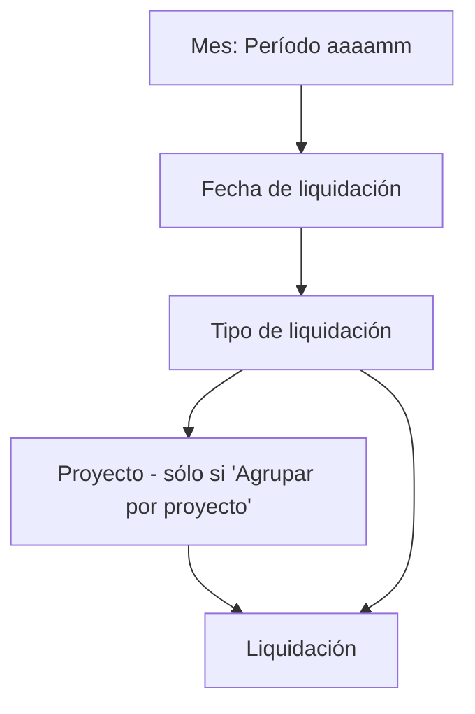

# Árbol de liquidaciones

**Caption:** *Árbol de Liquidaciones* · **Página 110017** · Role Center → Nómina · origen: tabla **temporal** `Árbol Liquidaciones Buffer`.

## Para qué sirve

Ver las liquidaciones **agrupadas con subtotales** y operar sobre un **nodo entero** (un mes, un tipo, una marea): calcular, aprobar, reabrir, eliminar o imprimir recibos de todo lo que cuelga de él, sin tildar fila por fila en la Lista. Las acciones usan el mismo codeunit que la Lista (`Lotes Liquidación Liq.`, Cod50076), así que se comportan igual ([[Crear, calcular, aprobar y reabrir liquidaciones]]).

## Cómo se lee

- **Con "Agrupar por proyecto" (por defecto):** Mes → Fecha → Tipo → Proyecto → Liquidación. Sirve para comparar una marea contra otra.
- **Sin tildar:** Mes → Fecha → Tipo → Liquidación: la **secuencia de trabajo del mes**, leída de arriba hacia abajo en el orden en que se liquidó (el nivel de proyecto parte cada tipo en tantos nodos como mareas haya).
- Los meses salen del **más reciente al más antiguo**; las fechas dentro del mes, cronológicas.
- Liquidaciones sin dato se agrupan en nodos *(sin proyecto)*, *(sin tipo de liquidación)*, *(sin mes)*, *(sin fecha)*: el nodo *(sin tipo…)* delata liquidaciones con `Cód. Tipo Liq.` en blanco ([[migracion-tipo-liq-incompleta]]).

### Columnas

| Caption | Qué muestra |
|---|---|
| *Mes / Fecha / Tipo / Proyecto / Liquidación* | El nodo; drill-down = *Abrir* |
| **Liq.** | Cantidad de liquidaciones que cuelgan del nodo |
| **Estado** | Sólo en la hoja: gris Borrador, ámbar Calculada, verde Aprobada/Contabilizada |
| **Total Haberes**, **Total Descuentos**, **Neto a Pagar** | Subtotales del nodo |
| **No. Empleado** | En la hoja |

### Filtros de arriba

| Campo | Efecto |
|---|---|
| **Agrupar por proyecto** | Cambia la presentación (arriba) |
| **Sólo el año de la fecha de referencia** | Tildado (por defecto): sólo períodos que **intersecan** ese año. Se hace por las fechas del período, no por el prefijo del código |
| **Fecha de referencia** | Arranca en la **fecha de trabajo** (el 2 de enero uno sigue cerrando diciembre) |

Si se abre acotado a un período (desde código) aparece **Ver todos los períodos**.

## Acciones

Todas actúan sobre **los nodos marcados**; si no hay selección, sobre el nodo donde está el cursor. Antes de ejecutar, la confirmación **nombra el nodo y la cantidad** de liquidaciones ("¿Calcular las 214 liquidación(es) que cuelgan de «Tipo CIERRE_MAREA»?"): **leer el número** — un alcance menor al esperado es la pista de que la selección no tomó todo. Después recarga el árbol y recalcula subtotales.

| Acción | Efecto | Estados que toma |
|---|---|---|
| **Abrir** | Sobre una hoja: la ficha. Sobre un nodo: la Lista filtrada | — |
| **Actualizar** | Relee y recalcula subtotales | — |
| **Calcular** | Calcula en orden de cálculo, con progreso y avisos | Sólo **Borrador** (las otras se omiten y se informan) |
| **Aprobar** | Aprueba | Sólo **Calculada** (omite el resto) |
| **Reabrir** | Vuelve a Borrador | Sólo **Calculada**, y salteando las que el empleado tenga con posteriores |
| **Eliminar** | Borra y pide confirmación con el tamaño del alcance | Sólo **Borrador** |
| **Imprimir Recibos** | Abre el informe con las liquidaciones del alcance | Todas (usar *Solo liquidaciones aprobadas/contabilizadas*) |

> [!note] Tooltip de *Calcular*
> El tooltip dice "estén en Borrador, Calculada o Aprobada", pero `Lotes.Calcular` sólo calcula **Borrador** y omite el resto con el aviso "reabrilas si querés recalcularlas".

## Cuidados

- **Marcar varios nodos y que sólo opere sobre uno** ya fue un bug de la plataforma (`SetSelectionFilter` sobre una variable temporal aparte devuelve vacío; ver [[setselectionfilter-tabla-temporal]]). El código actual lo evita; si la confirmación dice "1 liquidación" tras marcar seis proyectos, cancelar y avisar.
- Las acciones de lote **juntan las claves antes de tocar nada** porque cambiar el `Estado` saca el registro del filtro y el bucle se cortaba en la primera ([[bucle-modifica-campo-filtrado]]).
- Eliminar todas las liquidaciones de un nodo hace que el foco caiga al principio del árbol.

## Relacionado

[[Lanzador de liquidaciones y lotes]] · [[Flujo operativo mensual de liquidación]] · [[Mapa de páginas por menú]] · [[Tabla - Liquidación]]

## Ver también

[[Lotes de liquidación]] · [[Procesos por lotes y progreso]]
