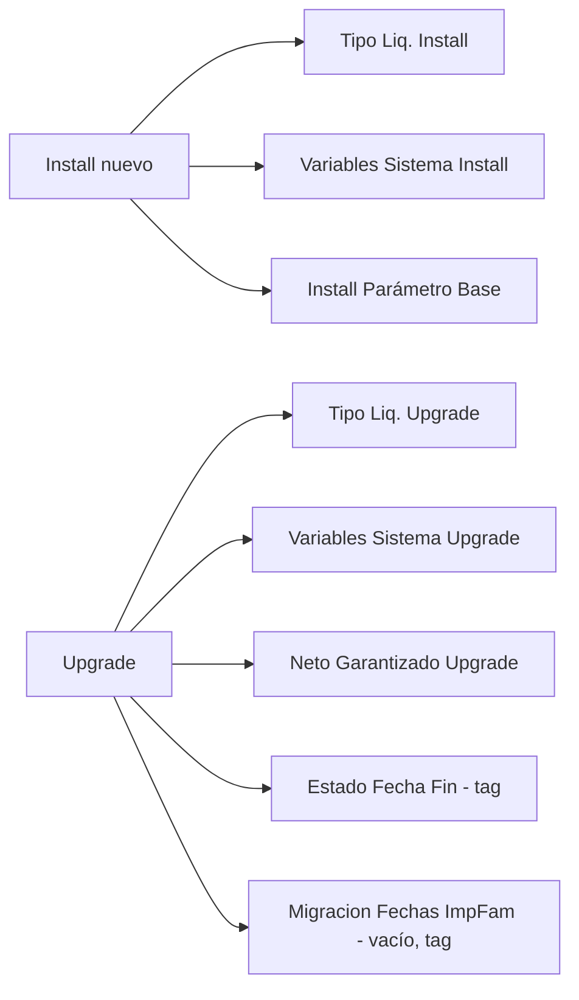

# Install y Upgrade - qué siembra cada uno

La extensión tiene **8 codeunits** `Subtype = Install` o `Upgrade`, todos **por empresa** (`OnInstallAppPerCompany` / `OnUpgradePerCompany`). No hay `OnUpgradePerDatabase` ni `OnCheckPreconditions`. Los que usan etiqueta lo hacen con el codeunit `Upgrade Tag` de la System Application.

> [!warning] Un publish de RAD no dispara Upgrade
> Los upgrades corren con `Start-NAVAppDataUpgrade` tras un publish completo ([[Publicar en BC (no usar RAD)]]). En desarrollo con RAD no corren nunca: hay que invocar a mano la acción equivalente (p. ej. *Sembrar* en la página Variables de Sistema). Ver [[variable-sistema-hay-que-sembrarla]].

## Cuadro resumen

| Codeunit (archivo → ID declarado) | Subtype | Qué hace | ¿Pisa lo cargado a mano? | ¿Tag? |
|---|---|---|---|---|
| `Tipo Liq. Install` (`Cod50056` → 50056) | Install | `Sembrar` + `MigrarDatos` + `ConfigurarDisparadores` de Tipo Liquidación | Sembrar no; ConfigurarDisparadores **converge** | no |
| `Tipo Liq. Upgrade` (`Cod50057` → 50057) | Upgrade | lo mismo, en cada upgrade | ídem | no |
| `Variables Sistema Install` (`Cod110049`) | Install | `Gestión Variables Sistema.Sembrar()` | no (sólo agrega faltantes) | no |
| `Variables Sistema Upgrade` (`Cod110050`) | Upgrade | lo mismo, en cada upgrade | no | **no, a propósito** |
| `Neto Garantizado Upgrade` (`Cod110038`) | Upgrade | siembra 2 punteros en Config. RRHH | no (sólo si están en blanco) | no |
| `Install Parámetro Base` (`Cod50049`) | Install | backfill de `Cód. Parámetro Base` en Parámetro Vigente | n/a | no |
| `Estado Fecha Fin Upgrade` (`Cod50062` → **50065**) | Upgrade | materializa `Fecha Fin` del historial de estados | sólo escribe donde difiere | `UAS-Payroll-EstadoEmpleado-FechaFin-20260807` |
| `Migracion Fechas ImpFam` (`Cod50082`) | Upgrade | **vacío**: sólo marca el tag | n/a | `UAS-Payroll-EmpRelative-MigracionFechasImpFam-50000-20260825` |

## Detalle

### Tipo Liquidación (`Gestión Tipo Liq.`, Cod50055)
`Sembrar()` inserta, si no existen, los siete tipos (código, descripción, orden, `Liquida al Arribo`, `Incluye Francos Puerto`):

| Código | Orden |
|---|---|
| `REGULAR` | 10 (incluye francos de puerto) |
| `AGUINALDO` | 20 |
| `VACACIONES` | 30 |
| `LIQ_FINAL` | 40 |
| `RELIQUIDACION` | 50 |
| `DEVENGADOS` | 60 |
| `CIERRE_MAREA` | 70 (liquida al arribo) |

`MigrarDatos()` reescribe en `Concepto Liquidación."Tipos Liq. Aplicables"` los captions viejos del enum por códigos (idempotente). `ConfigurarDisparadores()` completa `Disparador` desde las banderas viejas, deja `LIQ_FINAL` con disparador *BajaEmpleado*, define qué tipos **entran en la corrida** (`AGUINALDO` solo en meses 6 y 12), fija `VACACIONES` como **Aplica A = Tripulante** y las líneas de estado exigido (REGULAR: estado de proyecto no productivo; VACACIONES: estado AU9 que **empieza** en el período). Retira la regla vieja `AU9`/`MesSiguiente`. **Es converger, no sólo sembrar**: lo que el producto define se vuelve a imponer en cada upgrade (`AplicarA`, `RetirarEstado`); sólo se respeta lo agregado a mano en las líneas de estado. Saldo inicial, Hist. Remun. y Reliquidación **no** entran en la corrida: se crean a mano. Ver [[lote-tipo-liq-en-blanco]], [[tipo-liq-no-implementada]], [[migracion-tipo-liq-incompleta]].

### Variables de Sistema (`Gestión Variables Sistema.Sembrar()`, Cod50077)
Idempotente; devuelve cuántas insertó. Siembra ~29 variables estándar (`AÑOS_ANTIGUEDAD`, `DIAS_HAB`, `DIAS_FERIADOS*`, `DIAS_PROYECTO`, `DIAS_MAREA`, `DIAS_FRANCOS_PERIODO`, `FRANCOS_CONSUMIDOS`, `PAGO_FRANCOS_FIFO`, `SALDO_FRANCOS`, `PCT_ESCALA`, `VACACIONES_*`, `DIAS_VAC_PERIODO`, `MESES_PROM_*`, `DEDUC_GANANCIAS`, `MES_ANUAL`, `TIPO_LIQ`) más tres «por estado» (`DIAS_ENFERMEDAD`→AU1, `DIAS_ACCIDENTE`→ACC, `DIAS_ACC_PREVIOS`→ACC, función `DIAS_ESTADO_PREVIOS`). **No** siembra `YTD_ACUM` ni `YTD_LINEAS` (necesitan un parámetro: devolverían cero en silencio). El motivo de que existan Install y Upgrade: dejar de depender de acordarse de la acción manual; el error aparecía meses después como «Variable desconocida en la fórmula». Sin tag a propósito: es un catálogo que crece, un tag lo dejaría corriendo sólo la primera vez. Catálogo y convenciones: [[system-variables-conventions]].

### Neto garantizado (`Cod110038`)
Pone en `Human Resources Setup` (`TabExt52001`) los dos punteros que antes estaban a fuego en el motor: `Cód. Concepto Neto Garantizado` = `NETO_GARANT` y `Cód. Acum. Haberes Gravados` = `BASE_IG4`, **sólo si están vacíos** (puede correr una vez por empresa y de nuevo si se reinstala). Es **Upgrade solamente**: una instalación nueva no los siembra. El concepto `NETO_GARANT` **no** se crea acá; viene del ConfigPackage o se carga a mano ([[Backup y restauración - cómo reaplicar]]). Sin el concepto, el grossing-up queda sin aplicar, sin error.

### Install Parámetro Base (`Cod50049`)
Sólo **Install**. Para cada `Parámetro Vigente` con `Cód. Parámetro Base` vacío, busca el `Parámetro` de código más largo que sea igual o prefijo (`<Código>_`) y hace `Rename` de la PK. Es el backfill de cuando se introdujo la columna; en una base ya migrada no encuentra nada. Ojo con la PK `(Cód. Parámetro Base, Cód. Parámetro, Vigencia Desde)` ([[get-con-menos-argumentos]]).

### Estado Fecha Fin (`Cod50062.EstadoFechaFinUpgrade.al`, declara **codeunit 50065**)
Una sola vez por empresa (tag). Recorre `Estado Empleado` y deja `Fecha Fin` = día anterior al inicio del estado siguiente de la misma entidad; el último queda abierto (en blanco). `Modify()` sin disparar la sincronización de contigüidad (sería cuadrático). Contexto: [[estado-empleado-effective-dated]].

### Migracion Fechas ImpFam (`Cod50082`)
**Quedó sin efecto el 22/9/2026**: canonizaba fechas de impuesto/familiar en 50000/50001 y esa premisa era errónea (la deducción de Ganancias la deciden *Fecha alta impuesto* / *Fecha baja impuesto*). Se conserva la codeunit **vacía** y el tag, porque en los entornos donde ya corrió el tag está puesto, y borrarla dispararía la migración vieja en el próximo upgrade de los que no corrieron. **No borrar.** Ver [[familiar-alta-impuesto]].

## Diagrama de qué corre cuándo

## Cómo agregar uno

1. Decidir si es **catálogo que crece** (sin tag, idempotente) o **migración de una vez** (con `Upgrade Tag`, nombre `UAS-Payroll-<Tema>-<yyyymmdd>`).
2. Guardar el efecto: «sólo si está en blanco» o «converge», y escribirlo en el `remarks`.
3. Si siembra algo que antes se hacía a mano, no pisar lo configurado.
4. Si se jubila, dejar la codeunit vacía con el motivo (patrón `Cod50082`).
5. Actualizar esta nota y [[Backup y restauración - cómo reaplicar]].
